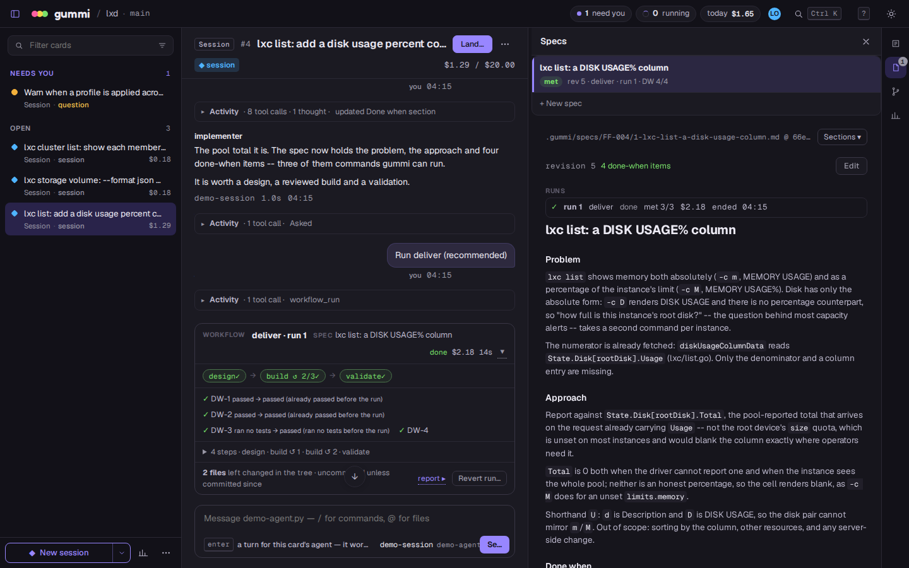

# gummi

> A meta-harness for coding agents. Run a fleet of agent sessions across
> git worktrees, run a workflow of fresh agents when the work is worth
> one, from one board or headlessly from your own agents and CI.


One coding agent is a pair programmer. Five are a management problem: a
pile of terminals, worktrees you keep straight in your head, and an agent
that has been silently waiting on a question for twenty minutes.

gummi replaces the pile of terminals with one board. Every piece of work
is a **session**: a coding agent on its own git worktree and branch,
that you talk to in its thread. When a piece of work deserves more than
one agent, the session can run a **workflow**:

```
session ──▶ spec ──▶ workflow proposed ──you allow──▶ run ──▶ report
```

A workflow is a recipe of steps — design, build, review, validate, or
whatever the recipe says — and each step is a fresh agent working in the
session's own tree, one after another, side by side, or round a loop
until a check passes. You allow the run (and any plan a step revises);
gummi snapshots the tree at every step, so each step has a diff of its
own and you can revert the run. The report comes back to the session,
the changes stay in its tree for it (or you) to commit, and landing a
session on main is always your read of its diff and your keypress.

## Features

- **One board for many agents** — every session runs in parallel on its
  own worktree and branch; anything that needs you lands in a single inbox.
- **Workflows when the work deserves them** — recipes kept as YAML in
  `.gummi/workflows/`, beside the bundled `deliver`, `investigate` and
  `fix-until-green`. A run is one block in the session's thread: open any
  step to read its transcript, its own diff and its brief, or to talk to
  it. At the end gummi runs the spec's "done when" checks and reports
  each item's result, in the run's block and in its report.
- **Specs when you want them** — a session can keep markdown specs, one
  per piece of work, with numbered revisions, that you read and annotate
  beside the thread. A run is judged against the spec it froze, not a
  transcript.
- **Pick the model per role** — the session, the planner, each step tier
  and the reviewer map to models through profiles: strong ones where they
  earn it, cheap or local ones elsewhere. Each session spends from a
  budget in dollars, and its workflow runs spend from the same budget.
  Nothing guesses what a run will cost: it goes on until the budget runs
  out, then pauses for a top-up rather than throwing work away.
- **Agents, schedules and heartbeats** — an agent is a session with a home
  of its own instead of a repository; a session can come back on a clock.
- **Stacks and PRs** — slice work into stacked branches; push a branch
  and open its pull request when you choose to.
- **Headless** — `gummi run` starts a session from a prompt and drives it
  and its workflow runs from scripts, CI or another agent, with NDJSON output and
  typed exit statuses.
- **In the browser** — `gummi web` serves the same board to a browser,
  over loopback or your tailnet, with each workflow run drawn in the
  thread as it goes.
- **Many backends** — Copilot CLI (default), Claude Code, Codex, opencode,
  pi, Antigravity, or any binary speaking a small stdio protocol.

## Install

gummi is a single binary. There are no releases yet, so install with the
Go toolchain (Go 1.26+):

```sh
go install github.com/morphis/gummi/cmd/gummi@latest
```

or build from a clone:

```sh
git clone https://github.com/morphis/gummi
cd gummi
make build        # → bin/gummi
```

You also need at least one agent backend installed and logged in. The
default is the GitHub Copilot CLI:

```sh
curl -fsSL https://gh.io/copilot-install | bash
```

`gummi doctor` checks that the backend, auth and profiles are ready.

## Usage

Run it inside a git repository:

```sh
cd your-repo
gummi
```

The first run creates a gitignored `.gummi/` with state, a starter
`config.yaml` and `profiles.yaml`. Then:

1. `n` — start a new session. The first line is the title.
2. `enter` — open it and talk to the agent in its thread, in the
   session's own worktree. For bigger work, ask it to write a spec and
   run a workflow; the proposal comes back to you as a decision.
3. `d` — read the diff and leave line comments the agent picks up.
4. `m` — squash-merge it into main once you are happy with the diff (or
   `h` to hand the branch off).

The keys you need first:

| key | does |
|---|---|
| `n` | new session |
| `enter` | open the selected card |
| `d` | the card's diff |
| `m` / `h` | squash-merge into main / hand the branch off |
| `?` | the full key table |

Headless, with nobody at the keyboard:

```sh
gummi run --envelope 5 "Add a --format=json flag to the export command"
gummi resume FF-042 --answer "yes"   # answer what it stopped on, and drive on
gummi merge FF-042 -m "export: add --format=json"
gummi skill install   # teach your own coding agent to drive gummi
```

In a browser:

```sh
gummi web             # http://127.0.0.1:7878, prints a pairing code
```



## Documentation

- [docs/HEADLESS.md](docs/HEADLESS.md) — the headless driver: `run` and
  `resume`, verbs, exit statuses, landing through a PR.
- [docs/CONFIGURATION.md](docs/CONFIGURATION.md) — backends, config files,
  hooks, environment variables, the web host.
- [docs/DESIGN.md](docs/DESIGN.md) — the design and its binding decisions.

## Development

```sh
make build   # build bin/gummi
make test    # run all tests
make ci      # build + test + lint
make demo    # a throwaway repo with gummi initialized
```

See [AGENTS.md](AGENTS.md) for the code layout and conventions.

## Security

Please do not report security vulnerabilities in public issues. See
[SECURITY.md](SECURITY.md) for how to report one privately.

## License

gummi is licensed under the [MIT License](LICENSE).
